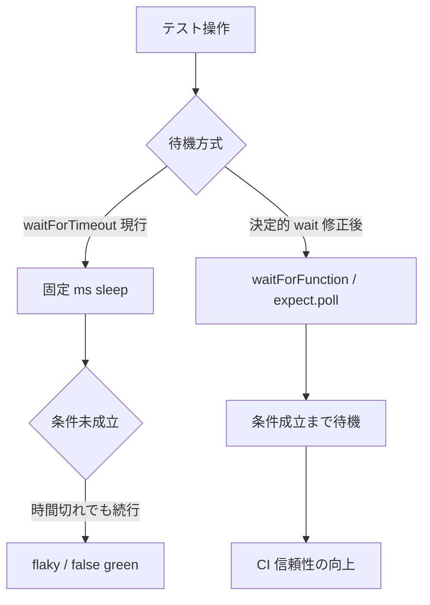

# E2E の `waitForTimeout(...)` を決定的待機に置き換える

- Priority: Medium
- Created: 2026-05-25
- Polished: 2026-10-15
- Model: Composer 2.5
- Branch: feature/refactor-e2e-waitfortimeout

## 目的

`e2e-tests/tests/` 配下の固定 `waitForTimeout(...)` を `waitForFunction` / `waitForSelector` / `expect.poll` 等の決定的待機に置き換え、flaky の根本原因を減らして CI 信頼性を上げる。issue 0027 (flaky 検出) は「対応不要」として closed になったため、本 issue が flaky の根本原因削減への唯一の対処として独立に実施する。

## 優先度根拠

Medium。0027 は「`retries: 3` は CI が不安定な環境下で flaky テストを許容するための意図的な設定であり、リリースブロッカーとなる不具合ではない」との判断で closed され、CI は引き続き flaky を retry で吸収して表面化しない (`playwright.config.ts` は `retries: 3` のまま)。そのため本 issue のような根本原因削減は CI が green を保ち続けるための継続的な品質作業であり、即時のブロッカーではないが価値は高い。0027 適用後のような「本対応が実質必須」の状態は発生しない。

## 現状

### 状態遷移



着手時に次で対象を網羅する:

```bash
rg -n "waitForTimeout" e2e-tests/tests/
```

2026-10-15 時点の結果: **13 ファイル、計 24 箇所** (`e2e-tests/tests/` 外のソースコードに `waitForTimeout` は無い。ただし後述のとおり stereo 2 ファイルの 5 箇所は issue 0029 の再開に合わせて置換する)。

**置換の根本原則:** 各 `waitForTimeout` は、その直後にテストが assert する条件のうち**経時変化する値** (bytesSent / bytesReceived / packetsSent / 受信解像度など) が、後続 assert の**方向 (outbound/inbound)・ページ (sendrecv は 2 ページ)・メディア種別 (audio/video)・閾値**をすべて満たすまで待つ条件に置き換える。outbound 片方向・単一ページ・`> 0` に単純化しない。静的構成 (codec 名・scalabilityMode など) は待機条件に含めず、置換後に残る assert がそのまま検出する (送出量などが先に揃ったスナップショットでも必ず assert される)。実装時は各 `waitForTimeout` の前後コードと対応 fixture (`e2e-tests/<fixture>/index.html` / `main.ts`) を必ず読み、後続 assert を確認してから置換する。

下表の「待機条件」は 2026-10-15 時点の develop (`6ea1cb84`) で後続 assert・fixture を確認した上での方針。対象箇所はファイルパスとシンボル名 (test 名・関数名・selector) で示す。

## 置換対象一覧

| ファイル | 対象箇所 | 待機条件 (後続 assert に合わせる) |
| --- | --- | --- |
| `authz_simulcast_encodings.test.ts` | `test("authz simulcast encodings")` の接続後 | 後続は `#pc-state` の `dataset.connectionState === "connected"` 待ちと `#connection-id:not(:empty)` 待ちの後に続く。これらは接続確立しか見ないため sleep の置換には不十分 (stats 送出を担保しない)。`#get-stats` クリック後に `#stats-report` の outbound-rtp を **r0 限定・video** で poll する。後続 assert は r0 の `bytesSent > 0` / `packetsSent > 2` / `scalabilityMode === "L1T1"` (fixture は `simulcast_sendonly`) と r1 / r2 の `bytesSent === 0`。`packetsSent` を `minValue: 3` で待つ (`bytesSent > 0` は同一エントリで同時に成立する。`scalabilityMode` は静的) |
| `stereo_audio.test.ts` | `test("stereo audio transmission test")` の接続後 | **双方向** (fixture: `fake_stereo_audio`、audio のみ)。送信側 `#stats-report` の outbound-rtp `bytesSent > 0` と、受信側 `[data-recv-stats-report-json]` の inbound-rtp `bytesReceived > 0` の両方を待つ。受信側は fixture の append 問題があるため「共通ヘルパー」の注記 (issue 0029 で対処) を参照。0029 対象のため本 issue では実施しない |
| `stereo_audio.test.ts` | `test("mono audio transmission test")` の接続後 | 送信側 outbound-rtp `bytesSent > 0` のみ (受信側には assert が無い。fixture は audio のみ)。上記とは別条件。0029 対象のため本 issue では実施しない |
| `stereo_audio_sendrecv.test.ts` | `test("stereo audio bidirectional transmission test")` の接続後 | **双方向** (fixture: `fake_stereo_audio_sendrecv`、audio のみ)。fixture は `#stats-report-1` / `#stats-report-2` の 2 要素で plain な `#stats-report` は無い。`statsSelector` にそれぞれを渡し、送信側 (outbound) / 受信側 (inbound) の各 `bytesSent > 0` / `bytesReceived > 0` を待つ (後続 assert は `findOutboundRtpStats` / `findInboundRtpStats` の audio を対象。`#audio-analysis` は静的 div を上書きする方式)。0029 対象のため本 issue では実施しない |
| `stereo_audio_sendrecv.test.ts` | `test("mono audio bidirectional transmission test")` の接続後 | **RTP stats の assert は無い** (後続は `getAnalysisData` の `dataset.analysis` のみ)。`#get-stats` クリック後に `#audio-analysis` の `dataset.analysis` 書き込みを `waitForFunction` / `expect.poll` で待つ (fixture は静的 div を上書きするため書ける)。0029 対象のため本 issue では実施しない |
| `stereo_audio_sendrecv.test.ts` | `test("mixed stereo/mono bidirectional transmission test")` の接続後 | 同上 (後続は `getAnalysisData` の `dataset.analysis` のみ)。`#get-stats` クリック後に `#audio-analysis` の `dataset.analysis` 書き込みを待つ。0029 対象のため本 issue では実施しない |
| `sendrecv.test.ts` | `test("sendrecv x2")` の 2 ページ接続後 | **双方向** (fixture: `sendrecv`)。各 page で outbound / inbound それぞれ **audio と video の両方** を待つ (後続 assert は各 page の audio / video 両方の outbound `bytesSent > 0` + `packetsSent > 0` と inbound `bytesReceived > 0` + `packetsReceived > 0`)。ヘルパーは `some` で単一エントリしか判定しないため `mediaType` を指定した 4 呼び出し/ページ。audio 送出だけで抜けさせない |
| `webkit.test.ts` | `test("WebKit")` の sendrecv 2 ページ接続後 | **双方向** (fixture: `sendrecv_webkit`)。sendrecv と同様、各 page で audio / video 両方の outbound / inbound を待つ (後続 assert は `findOutboundRtpStats` / `findInboundRtpStats` の audio / video について `bytesSent > 0` / `bytesReceived > 0`)。`mediaType` を指定した 4 呼び出し/ページ |
| `webkit.test.ts` | `test.fail("WebKit Authz simulcast_encodings ScaleResolutionDownTo")` の接続後 (fixture: `simulcast_sendonly_webkit`、video のみ) | `#connection-id:not(:empty)` は直前で待機済み。後続 assert は r0 / r1 の `bytesSent > 500` + `packetsSent > 50` と r2 の `bytesSent === 0` (scalabilityMode assert はコメントアウト中のため対象外)。**r0 と r1 の両方** を rid 付きで待つ (`minValue` は 501 / 51)。`bytesSent >= 1` で抜けると直後の `> 500` assert が flaky のまま残る |
| `simulcast_rid.test.ts` | `test("simulcast sendonly/recvonly pages")` の 2 ページ接続後 | **両 page** (fixture: `simulcast_sendonly` / `simulcast_recvonly`、video のみ)。sendonly は r0 / r1 / r2 **すべて** の outbound `bytesSent > 0` + `packetsSent > 0` + `scalabilityMode === "L1T1"`、recvonly は inbound video `bytesReceived > 0` + `packetsReceived > 0`、さらに recvonly の `frameWidth` / `frameHeight` が sendonly r1 と一致 (後続 assert は `findOutboundRtpStatsByRid` / `findInboundRtpStats`)。**「全 rid の AND」「文字列比較」「2 ページ間の比較」を含むため共通ヘルパーでは表現できない。テスト独自の `expect.poll` で書く** (置換例参照) |
| `simulcast.test.ts` | `test("simulcast sendonly/recvonly pages")` の接続後 | 後続は 3 rid すべての outbound `bytesSent > 0` + `packetsSent > 0` + `scalabilityMode === "L1T1"`。`#stats-report` は静的 div のため `waitForSelector` は no-op、また `#get-stats` クリック後の単一スナップショット読み取りは非同期書き込みと race する。**削除ではなく決定的待機に置換**する: 3 rid それぞれで `bytesSent` / `packetsSent` を poll (`waitForRtpStat` を rid 付きで 6 回。`scalabilityMode` は静的のため poll に含めず、同一スナップショットの assert で検出)。`#get-stats` クリックは poll 内で再クリックする (共通ヘルパー) |
| `sendonly_recvonly.test.ts` | `test("sendonly/recvonly pages")` の sendonly / recvonly 接続後 | sendonly (fixture: `sendonly`): `#stats-report` の outbound-rtp を **audio と video の両方** 待つ (後続 assert は `findOutboundRtpStats(..., "audio")` / `"video"` の `bytesSent > 0` + `packetsSent > 0`)。recvonly (fixture: `recvonly`): inbound-rtp を audio と video の両方待つ (`findInboundRtpStats` の `bytesReceived > 0` + `packetsReceived > 0`)。`mediaType` を指定 (各 2 呼び出し/ページ) |
| `sendonly_audio.test.ts` | `test("sendonly audio pages")` の接続後 | sendonly (fixture: `sendonly_audio`、audio のみ `video: false`)。`#stats-report` の outbound-rtp `bytesSent > 0` + `packetsSent > 0` を待つ (audio のみのため `mediaType: "audio"` を明示すると意図が明確) |
| `rpc.test.ts` | `test("RPC で simulcast rid を切り替えられる")` の初期解像度取得前 | r0 で開始 (fixture: `rpc`、video のみ)。`#video-resolution` は remote video の `resize` イベント (`rpc/main.ts` の `ontrack`) でのみ更新される。`#rpc-methods` の内容確認・`#switched[data-switched="true"]` 待機は既存だが、解像度はまだ未測定の可能性がある。`getVideoResolution` が width / height とも 0 より大きくなるまで `expect.poll` (後続 assert は `initialResolution.width > 0` / `height > 0`) |
| `rpc.test.ts` | `test("RPC で simulcast rid を切り替えられる")` の r1 切替後の解像度反映待ち | `#current-rid` の `dataset.currentRid === "r1"` 待機と `getRpcResult` の `rid: "r1"` 検証は既存。以降 `getVideoResolution` が **`initialResolution` より大きく** なるまで `expect.poll` (後続 assert は `r1Resolution` の width / height 両方の `toBeGreaterThan(initialResolution.*)`。`#video-resolution` の更新は resize イベント起点) |
| `rpc.test.ts` | `test("RPC で simulcast rid を切り替えられる")` の r0 復帰後の解像度反映待ち | `#current-rid` の `dataset.currentRid === "r0"` 待機と `getRpcResult` の `rid: "r0"` 検証は既存。以降 `getVideoResolution` が 0 より大きく、かつ **`r1Resolution` より小さく** なるまで `expect.poll` (後続 assert は `r0Resolution` の width / height 両方の `> 0` と `toBeLessThan(r1Resolution.*)`。未測定の 0 は r1 より小さいため `> 0` の確認が必須) |
| `h265.test.ts` | `test("H265")` の 2 ページ接続後 | **双方向** (fixture: `h265`、audio と video を送出するが **後続 assert は video のみ**)。各 page で outbound video `bytesSent > 0` + `packetsSent > 0` と inbound video `bytesReceived > 0` + `packetsReceived > 0` を待つ (`mediaType: "video"`。audio は assert されないため待つ必要は無い) |
| `spotlight_sendrecv.test.ts` | `test("spotlight sendrecv x2")` の 2 ページ接続後 | テストは stats を一切読み取らない (RTP stats の assert が存在しない。fixture `spotlight_sendrecv/main.ts` に `#get-stats` ハンドラは無く、index.html のボタンは dead)。直前の `#connection-id:not(:empty)` 待機で接続確立は担保済みのため **削除** する |
| `reconnect.test.ts` | `test("sendonly_reconnect type:reconnect pages")` の接続後 | テストは `#stats-report` / `#get-stats` を一切使わない。後続 assert は `#api-disconnect-status` の "success" と、再接続後の `#connection-id` が元と異なること、`#reconnect-log` の "Success" のみで **stats 系の assert は存在しない**。fixture (`sendonly_reconnect`) の `#stats-report` は `#get-stats` クリック時のみ書かれるため、メディア送出を待つと「テストが読まないデータ」への待機になる。直前に `#connection-id:not(:empty)` を待機済みで接続確立は担保されるため **削除** する |
| `connected_callback.test.ts` | - | `waitForTimeout` を使用しないため対象外 |
| `spotlight_sendonly_recvonly.test.ts` | - | `waitForTimeout` を使用しないため対象外 |

**置換後の残件:** 24 箇所のうち、本 issue で置換するのは 19 箇所 (上表)。stereo 2 ファイルの 5 箇所は issue 0029 と同時に対応する (後述)。

## 共通ヘルパー (推奨)

`e2e-tests/tests/helper.ts` に次を追加する (既存の import は `type { Page }` のみなので、`expect` を value import として追加する: `import { expect } from "@playwright/test"` を helper.ts の import 文に追加する)。

```ts
export async function waitForRtpStat(
  page: Page,
  kind: "outbound-rtp" | "inbound-rtp",
  field: "bytesSent" | "bytesReceived" | "packetsSent" | "packetsReceived",
  minValue = 1,
  statsSelector = "#stats-report",
  datasetKey = "statsReportJson",
  rid?: string,
  mediaType?: "audio" | "video",
): Promise<void> {
  await expect
    .poll(async () => {
      await page.click("#get-stats");
      return page.evaluate(
        ({ statsSelector, datasetKey, kind, field, minValue, rid, mediaType }) => {
          const json =
            document.querySelector<HTMLElement>(statsSelector)?.dataset[datasetKey] ?? "[]";
          const stats = JSON.parse(json) as Array<Record<string, unknown>>;
          return stats.some(
            (s) =>
              s.type === kind &&
              (rid === undefined || s.rid === rid) &&
              (mediaType === undefined || s.kind === mediaType) &&
              Number(s[field] ?? 0) >= minValue,
          );
        },
        { statsSelector, datasetKey, kind, field, minValue, rid, mediaType },
      );
    })
    .toBe(true);
}
```

- 引数の役割 (`minValue` / `statsSelector` / `datasetKey` / `rid` / `mediaType`):
  - `minValue` は後続 assert の閾値以上にする。`>= 1` で抜けると直後の `> 500` / `> 2` 等の assert が flaky のまま残る (例: authz の r0 は `packetsSent` を `minValue: 3`、webkit の `test.fail` は `bytesSent` を `minValue: 501` / `packetsSent` を `minValue: 51`)。
  - `rid` / `mediaType` は省略可。stats エントリには `rid` / `kind` フィールドがあり (helper.ts の `findOutboundRtpStats` / `findOutboundRtpStatsByRid` が同じフィールドで絞っている)、省略時は「いずれかの該当エントリ」で成立する (`some`)。
  - `expect.poll` の既定 timeout は短いため、既存の `waitForFunction` と同じ `{ timeout: 15_000 }` を渡す (メディア確立は低速環境では数秒かかる)。このヘルパー内でも同様に指定する。
  - **`some` の制約:** 「複数エントリの同時条件 (全 rid)」「文字列フィールド (scalabilityMode)」「2 ページ間の比較 (frameWidth 一致)」はこのヘルパーでは表現できない。該当箇所 (simulcast / simulcast_rid、比較部分) はテスト独自の `expect.poll` を使う (置換例参照)。

- 呼び出し例:
  - 送信側 (sendonly / 双方向の送信): `await waitForRtpStat(page, "outbound-rtp", "bytesSent")`
  - 受信側 (recvonly): `await waitForRtpStat(page, "inbound-rtp", "bytesReceived")`
  - rid で絞る (authz / webkit の `test.fail`): `await waitForRtpStat(page, "outbound-rtp", "bytesSent", 501, "#stats-report", "statsReportJson", "r0", "video")`
  - メディア種別で絞る (sendrecv / webkit / h265): `await waitForRtpStat(page, "outbound-rtp", "bytesSent", 1, "#stats-report", "statsReportJson", undefined, "video")`
  - 双方向テスト (sendrecv / webkit の sendrecv 部 / h265): 各 page で outbound / inbound × 対象メディア種別の分だけ呼ぶ (video のみ assert の h265 は 2 回/ページ、audio と video 両方 assert の sendrecv は 4 回/ページ)。

- `stereo_audio_sendrecv.test.ts` 相当 (fixture: `fake_stereo_audio_sendrecv`) は `statsSelector` に `#stats-report-1` / `#stats-report-2` を渡す (plain な `#stats-report` は存在しない)。

- **`stereo_audio.test.ts` の受信側 (fixture: `fake_stereo_audio`):** fixture は `#get-stats` クリック毎に `[data-recv-stats-report-json]` div と `#audio-analysis` div (id 重複) を **append** する (`fake_stereo_audio/main.ts` の `#get-stats` クリックハンドラ)。`document.querySelector` / `page.$eval` は常に**最古**の div を返すため、`dataset.recvStatsReportJson` / `dataset.analysis` は更新されず、テスト側の `getRecvStatsReportJson` / `getAnalysisData` も最古を読む。**fixture を「上書き」(append をやめ既存要素に dataset を設定) に直すのが唯一の完全な対処**であり、ヘルパー側で最後の要素を読むだけではテスト側の assert は直らない。0029 再開時に実施する (本 issue では stereo 2 ファイルに触れない)。

- **disconnect 後に stats を読むテスト** (authz / webkit の `test.fail` ブロック) は、この poll を disconnect より**前**に置く (PeerConnection 閉鎖後は getStats が失敗する)。

- get-stats を使わない、または stats を assert しないテスト (`spotlight_sendrecv` / `reconnect`) はこのヘルパーを使わず **削除** する。

## 設計方針

- 既存の `#get-stats` ボタンをクリックしてから stats を読む挙動 (getStatsReportJson 等) はできるだけ活かし、`waitForTimeout` 部分だけを poll に置き換える。
- `#stats-report` は静的 div であり `waitForSelector` は no-op。**stats は `#get-stats` クリックで初めて書かれる**ため、poll の各回で `#get-stats` をクリックしてから `dataset.statsReportJson` を読む (上記ヘルパー)。
- 各 `waitForTimeout` は下表の方針に従い、対応する fixture の DOM / stats を実際に確認してから置換する (推定で置換しない)。
- `simulcast` は get-stats を使うが、後続 assert が全 rid を対象とするため、共通ヘルパーを rid 付きで個別呼び出しするかテスト独自 poll を使う (全 rid の AND を待つ)。
- `simulcast_rid` は「全 rid の AND」「文字列比較」「2 ページ間の比較」を含むため、共通ヘルパーを使わずテスト独自の `expect.poll` で書く。

### 0029 との関係

`stereo_audio.test.ts` / `stereo_audio_sendrecv.test.ts` は issue 0029 (stereo の stats / SDP assert 強化) と**同一のテスト関数・fixture を変更する**ため、本 issue では stereo 2 ファイルの 5 箇所を実施せず、0029 再開時に 0029 と併せて置換する (先行して本 issue を当てると 0029 再開時に衝突する)。0029 は現在 pending (2026-06-15 に `/auto-resolve 0029` で作成した PR #741 の CI が stereo audio 系 3 件で fail し、Sora の `audio.opus_params.minptime` 仕様確認などの設計判断が必要なため pending に戻されている)。

- 0029 側は「`waitForTimeout` 置換 (issue 0032)」をスコープ外と明記している。置換作業の責務は本 issue にあり、0029 再開時に 0029 の変更 (stats / SDP assert 追加) と同時に実施する (同一テスト関数・fixture を 0029 のブランチで触るため)。
- `fake_stereo_audio` の append 問題 (`#get-stats` クリック毎に `[data-recv-stats-report-json]` div と重複 id の `#audio-analysis` を append) は **`stereo_audio.test.ts` の受信側のみ**。`stereo_audio_sendrecv.test.ts` (fixture: `fake_stereo_audio_sendrecv`) は静的 div 上書きのため append 問題は無く、既存ヘルパー呼び出しの `statsSelector` 指定 (`#stats-report-1` / `#stats-report-2`) で対応できる。0029 再開時の実施内容は「`fake_stereo_audio` の fixture 上書き化」「決定的待機への置換」「0029 の stats / SDP assert 追加」で、`expect.poll` 待機と 0029 の assert 追加は矛盾しないよう統合する。
- 本 issue では 5 箇所を置換しないため、置換対象は 19 箇所で確定とする (下表)。
- 0029 が pending のままである限り、本 issue の完了条件は stereo 2 ファイル以外 (19 箇所) の完了をもって満たす。

### 0027 との関係

0027 (flaky 検出) は「対応不要」として closed。本 issue は flaky の根本原因削減 (固定 sleep の全廃) のみを目的とし、retry 設定等には触れない。

## 完了条件

- `rg -n "waitForTimeout" e2e-tests/tests/` のヒットが **stereo 2 ファイル (`stereo_audio.test.ts` / `stereo_audio_sendrecv.test.ts`) 以外で 0 件** になる (stereo 2 ファイルの 5 箇所は 0029 再開時に 0029 と併せて置換する)。本 issue のブランチでは 19 箇所を置換 (または削除) して完了とする。
- 置換した待機が、置換前に擬似再現した flaky (低速環境での待ち不足) で規定期間・回数実行しても再現しないこと。
- 共通ヘルパーで待てない箇所 (rpc.test.ts の解像度の大小比較、simulcast.test.ts / simulcast_rid.test.ts の全 rid・文字列比較・2 ページ間比較) は、テスト独自の `expect.poll` で正しく待てていること。
- `stereo_audio.test.ts` / `stereo_audio_sendrecv.test.ts` の 5 箇所は issue 0029 (pending、stereo の stats / SDP assert 強化) と同一のテスト関数・fixture を触るため、0029 再開時に併せて置換する (本 issue は対象外)。`stereo_audio.test.ts` (fixture: `fake_stereo_audio`) の受信側のみ append 問題 (`[data-recv-stats-report-json]` と重複 id の `#audio-analysis` をクリック毎に append) があり、fixture を上書き方式に直すのが唯一の完全な対処。`stereo_audio_sendrecv.test.ts` 側は静的 div 上書きのため append 問題は無い。0029 再開時に、fixture の上書き化・本 issue の決定的待機・0029 の assert 追加を整合させて行う。
- `package.json` の `e2e-test` script が参照する project 名は Playwright に存在しない (`e2e-test` script は project 名 `chromium` を参照しているが、`playwright.config.ts` の project 名は `Chromium`。`e2e-test:chromium` 側は正常)。**キャッシュ削除や script 修正は本 issue のスコープ外**とする。

### 置換例

#### 双方向テストの送受信 (sendrecv.test.ts / webkit.test.ts 相当、1 ページで送受信)

```ts
// audio と video の両方を assert する双方向テスト (sendrecv.test.ts 相当)
await waitForRtpStat(page, "outbound-rtp", "bytesSent", 1, "#stats-report", "statsReportJson", undefined, "audio");
await waitForRtpStat(page, "outbound-rtp", "bytesSent", 1, "#stats-report", "statsReportJson", undefined, "video");
await waitForRtpStat(page, "inbound-rtp", "bytesReceived", 1, "#stats-report", "statsReportJson", undefined, "audio");
await waitForRtpStat(page, "inbound-rtp", "bytesReceived", 1, "#stats-report", "statsReportJson", undefined, "video");
```

`h265.test.ts` は後続 assert が video のみのため、各 page で outbound / inbound の video 2 呼び出しにする。`sendonly_recvonly.test.ts` は送信ページ (outbound) と受信ページ (inbound) が分かれているため、各ページで audio / video の 2 呼び出しにする。

#### RPC の解像度反映 (rpc.test.ts 相当、`getVideoResolution` を使う)

```ts
// 初期解像度取得前: width / height とも 0 より大きくなるまで待つ
await expect
  .poll(async () => {
    const { width, height } = await getVideoResolution(page);
    return width > 0 && height > 0;
  })
  .toBe(true);
const initialResolution = await getVideoResolution(page);
expect(initialResolution.width).toBeGreaterThan(0);
expect(initialResolution.height).toBeGreaterThan(0);

// r1 切替後: currentRid が "r1" であること・getRpcResult の rid が "r1" であることを確認してから
await expect
  .poll(async () => {
    const { width, height } = await getVideoResolution(page);
    return width > initialResolution.width && height > initialResolution.height;
  })
  .toBe(true);
const r1Resolution = await getVideoResolution(page);
expect(r1Resolution.width).toBeGreaterThan(initialResolution.width);
expect(r1Resolution.height).toBeGreaterThan(initialResolution.height);

// r0 復帰後: currentRid が "r0" であること・getRpcResult の rid が "r0" であることを確認してから
await expect
  .poll(async () => {
    const { width, height } = await getVideoResolution(page);
    return (
      width > 0 && height > 0 &&
      width < r1Resolution.width && height < r1Resolution.height
    );
  })
  .toBe(true);
const r0Resolution = await getVideoResolution(page);
expect(r0Resolution.width).toBeGreaterThan(0);
expect(r0Resolution.height).toBeGreaterThan(0);
expect(r0Resolution.width).toBeLessThan(r1Resolution.width);
expect(r0Resolution.height).toBeLessThan(r1Resolution.height);
```

#### 全 rid (simulcast.test.ts 相当)

```ts
// scalabilityMode は静的構成のため poll に含めず、後続 assert で検出する
await expect
  .poll(async () => {
    await page.click("#get-stats");
    return page.evaluate(() => {
      const json =
        document.querySelector<HTMLElement>("#stats-report")?.dataset.statsReportJson ?? "[]";
      const stats = JSON.parse(json) as Array<Record<string, unknown>>;
      return ["r0", "r1", "r2"].every((rid) => {
        const s = stats.find((entry) => entry.type === "outbound-rtp" && entry.rid === rid);
        return (
          s !== undefined &&
          Number(s.bytesSent ?? 0) > 0 &&
          Number(s.packetsSent ?? 0) > 0
        );
      });
    });
  })
  .toBe(true);
```

#### 全 rid + 2 ページ間の比較 (simulcast_rid.test.ts 相当)

```ts
// scalabilityMode は静的構成のため poll に含めず、後続 assert (findOutboundRtpStatsByRid) で検出する
await expect
  .poll(async () => {
    await sendonly.click("#get-stats");
    await recvonly.click("#get-stats");
    const sendonlyStats = JSON.parse(
      await sendonly.$eval("#stats-report", (el) => el?.dataset.statsReportJson ?? "[]"),
    ) as Array<Record<string, unknown>>;
    const recvonlyStats = JSON.parse(
      await recvonly.$eval("#stats-report", (el) => el?.dataset.statsReportJson ?? "[]"),
    ) as Array<Record<string, unknown>>;
    const byRid = (rid: string) => (s: Record<string, unknown>) =>
      s.type === "outbound-rtp" && s.rid === rid;
    const r0 = sendonlyStats.find(byRid("r0"));
    const r1 = sendonlyStats.find(byRid("r1"));
    const r2 = sendonlyStats.find(byRid("r2"));
    const recv = recvonlyStats.find((s) => s.type === "inbound-rtp" && s.kind === "video");
    return (
      [r0, r1, r2].every(
        (s) =>
          s !== undefined &&
          Number(s.bytesSent ?? 0) > 0 &&
          Number(s.packetsSent ?? 0) > 0,
      ) &&
      recv !== undefined &&
      Number(recv.bytesReceived ?? 0) > 0 &&
      recv.frameWidth === r1?.frameWidth &&
      recv.frameHeight === r1?.frameHeight
    );
  })
  .toBe(true);
```

#### 削除する箇所 (spotlight_sendrecv / reconnect)

```ts
// 削除のみ。後続に stats 系の assert が存在しないため置換先は無い
```
